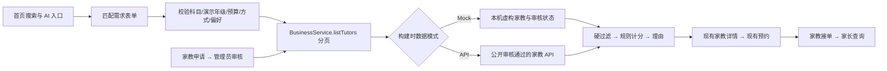

# 匹配设计与创新点

## 数据与接口

`src/services/matching.ts` 与身份、预约流程解耦，复用现有异步业务契约，不创建孤立的老师列表。本轮只为家教类型增添可选照片与自述评分字段，旧预约结构不变。完整分页读取 50 条/页，按 ID 去重；100 页上限明确报错；网络中断不返回半成品或冒充 API 的虚构结果。结果链接使用实际 `tutor.id` 进入原详情与预约。

年级仅为演示摘要。需求输入不应包含学生姓名、联系方式、学校等敏感信息，平台不保存匹配需求；用户主动选择模型解析时，简短需求会发送给已配置的第三方服务，见 [模型接入说明](MODEL_INTEGRATION.md)。偏好只按公开简介、专业、地区、标签匹配，最多 40 字，以空格或中英文标点分词并去重。不宣称理解复杂语义。

## 规则与解释

1. 必填：受支持的科目、演示年级；预算必须为 0.01–2000 元的十进制数字，最多两位小数。
2. 硬过滤：科目包含；课时费不超过预算；方式相同或家教支持“均可”（用户“均可”接受任意方式）。不自动提高预算或放宽条件。
3. 现行默认权重：教学经历 30、相关课程成绩 20、教学能力 20、匿名案例数 15、偏好 10、价格余量 5。用户可在匹配页分别调整 0–50；总权重归一到 100。经历以 36 个月封顶，成绩自述 0–100，教学能力自评 0–5，匿名案例数以 10 个封顶，偏好按关键词命中率，价格余量为 `1 − 价格/预算`。单项分数为 `round(100 × 权重/总权重 × 比例)`，合计上限 100。缺失项记 0；科目与方式已是硬条件，不再加固定分。
4. 同分选位置时线下片区参考距离近者优先，再按课时费升序、ID 字典序。分数只表示当前权重下的规则排序值，**不是**资质认证、能力核验、成功概率或效果保证。自述字段可夸大，真实上线前需要证据、审核和反馈机制。
5. 空结果同时给出各类排除数（按科目→预算→方式的首个失败条件统计），引导用户自行调整条件。

## 可展示的创新

- 可解释需求撮合：把需求、过滤、计分和推荐理由同时展示，避免“黑箱”演示。
- 无密钥可复现：确定性规则支持离线 Mock 备份，未接入大模型时明确展示“规则演示”。未来模型只可用于可选的需求解析，核心过滤应继续可测试。
- 可选需求解析：API 模式配置模型后，用户可主动提交简短需求；服务端只返回受约束的字段建议，由用户确认再填入表单。家教候选、排序和理由仍由上述规则产生，模型不接触预约或家教名单。配置与边界见 [模型接入说明](MODEL_INTEGRATION.md)。
- 推荐与业务闭环：同一服务源，推荐结果直接进入预约；审核后的公开家教与匹配数据一致。

这些是本项目实现特点，不声称行业首创。尚无真实用户实验、匹配准确率、学习效果或商业收入证据。模型适配器和受限需求解析入口已实现，但未使用真实供应商密钥验证调用；真实微信认证、真实资质核验、支付与通知不在已完成范围。照片与自述字段的审核边界见 [照片与评分说明](TUTOR_PHOTOS_RANKING.md)。
