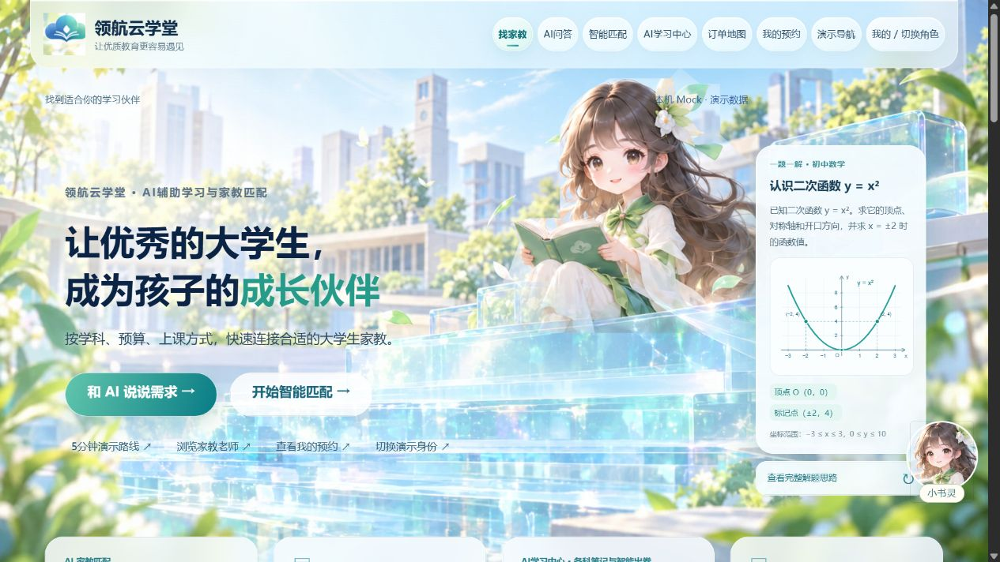

# 领航云学堂

AI赋能的校园家教智能匹配与个性化学习服务平台

作品介绍文档　2026年10月24日

**作品名称**　领航云学堂——AI赋能的校园家教智能匹配与个性化学习服务平台

**关键词**　AI伴学、智能师生匹配、学情分析、个性化训练、学情档案

## 一 作品概要

领航云学堂面向学生、家长与大学生家教，以“云伴学”AI伙伴串联找老师、学习答疑、作业辅导和教学反馈。学生表达学习需求，家长核对推荐理由并发起预约；教师在接受预约后安排课程、收交作业、记录课堂表现，再依据学习证据调整下一课。平台把家庭的学习需求与教师的教学工作连接在同一服务流程中。

我们的建设重点是让作业反馈继续用于学习：在已有模型接入与教学版本管理基础上，进一步联动作业诊断、针对训练和教师备课报告，并规划长期学情档案，使学生更换教师时仍能延续已积累的学习记录。AI提供分析与建议，学生和家长保留选择权，教师负责复核与教学决策。

<!-- FLOW: 表达需求|推荐家教|预约教学|作业反馈|训练备课 -->

平台已有可运行原型；作业到备课的完整联动、长期档案及跨教师授权属于后续建设。文中“云伴学”为整体AI服务定位，当前网页伙伴形象名为“小书灵”。

<!-- PAGE -->

## 二 解决的教育与产业痛点

赛道定位：本作品选择“赛道一：AI+高等教育”下的“AI+教学”方向，兼顾大学生教育实践与AI辅助教学协作。大学生家教可借助备课、课堂记录、反馈复核和版本修订开展教学实践；初一数学案例仅用于验证系统流程，不将其改写为高校课程覆盖或真实高校教学成效。

### 需求沟通重复 选师依据难比较

家长通常需要分别说明科目、预算、地点、空闲时间和教学偏好，教师也需要反复判断是否能够承接。平台把需求整理为可核对的条件，将教师公开资料、时间兼容性与价格放在同一比较框架中，减少信息来回转述。

### 地点和时间不合适 影响线下服务衔接

只按学科筛选，仍可能出现距离远、时间不吻合的问题。平台以公共服务片区和参考距离辅助选择，并展示订单片区与状态，为家长和教师评估线下安排提供依据。交通路线与通勤耗时将作为后续扩展，不把直线距离当作实际通勤时间。

### 作业检查与后续练习脱节

学生需要知道错误发生在哪一步、涉及哪个知识点，以及接下来怎样练习。云伴学已有文字与图片作业辅导接口，进一步建设的重点是把逐题反馈归类为可核对的错因，再安排相应的巩固与迁移练习。

### 教师备课缺少连续的学习依据

教师需要同时了解本次课堂表现、课后作业和上一轮训练结果。平台已有课堂事实、反馈和课程修订记录，规划中的备课报告将汇总这些证据，帮助教师确定下一课应复习、强化或顺延的内容。

### 学习记录分散 换老师后需要重新了解学生

作业、反馈和有效教学方法若只停留在单次沟通中，后续教师很难接续。我们规划由学生及家长掌握授权的学情档案，保留必要学习过程，在更换教师时提供经过确认的交接摘要，使教学衔接有据可查。

<!-- FLOW: 家长明确需求|学生获得反馈|教师调整教学 -->

平台同时连接家长、学生、大学生家教与管理者。入驻审核、预约状态和举报处理支撑服务流程；大学生家教获得公开展示与接单入口，但其教学资质仍需正式落地时进一步核验。

<!-- PAGE -->

## 三 核心功能与技术创新点

### 3.1 云伴学统一学习服务入口

学生和家长可通过伙伴形象进入需求整理、平台指引、知识答疑和作业辅导。兼容浏览器还支持语音输入与答复朗读，保留文字操作。学习中心已有22份原创入门笔记、66道固定示例题，支持自测、答案解析及有无答案导出；配置模型后，可围绕选定主题生成练习草案。

### 3.2 需求理解与透明规则协同匹配

模型可辅助解析学生需求，由用户确认后使用。平台先按学科、预算、授课方式和所选距离筛选，再按学科、时间、经验、费用及其他偏好评分。默认权重35／30／20／10／5，可自行调整，并展示分项理由。推荐结果直接进入教师详情与原预约流程；模型不自行编造老师名单或替用户下单。

### 3.3 地图连接线下教学安排

教师可登记公开服务片区，家长选择附近公共地点作为参考。地图与订单信息联动，API模式按角色权限定期更新预约状态，不公开学生称呼、联系方式或住址。当前支持预约与接单，站内即时聊天和音视频教学尚待建设。

<!-- NOTE: 创新价值|以统一伙伴入口连接自主学习与人工教学；推荐条件、排除原因和评分依据可查看，用户可以核对并作出选择。 -->

<!-- PAGE -->

## 三 核心功能与技术创新点

### 3.4 作业诊断联动训练与教师备课

平台已有服务端文字对话和单张作业图片辅导接口。用户主动提供题目与作答，模型可给出逐题判断、关键步骤、修改建议及复习知识点；图片入口需要明确同意，并要求遮挡个人信息。生成依赖已配置且支持相应输入的模型，不清晰或缺少条件的内容应标为无法判断。

下一步将作业辅导与课次记录、练习生成及教师端连接。分析结果先关联具体题目和学生作答，区分概念理解、方法选择、计算过程与表达问题，再生成训练草案。先巩固同类错误，再安排变式或迁移任务，教师可修改、采纳或退回。

<!-- FLOW: 提交脱敏作业|逐题诊断|生成针对训练|训练后复核|教师备课 -->

### 教师备课报告的规划内容

| 报告部分 | 提供的教学依据 |
| --- | --- |
| 本次任务概况 | 课次、题目范围、完成情况及需人工确认的内容 |
| 逐题证据 | 题号、作答要点、判断依据与识别不确定项 |
| 薄弱点分析 | 错因、关联知识点、已有证据及尚待验证的判断 |
| 针对训练 | 建议练习、设置理由、参考解法与再次检查方式 |
| 下一课建议 | 优先巩固内容、教学活动、时间安排与衔接目标 |
| 教师复核记录 | 采纳、修改或驳回的意见及报告版本 |

<!-- NOTE: 建设阶段|现有批改接口、主题出卷和课程反馈提供基础；基于真实提交作业自动联动训练、形成结构化备课报告并回写课次，尚待集成与验收。上表是报告方案，不是已经上线的报告页面。 -->

这项设计使学生的练习结果成为教师备课的输入。模型建议始终保留证据和不确定项，教师作出最终教学判断，不用自动评分替代正式学业评价。

<!-- PAGE -->

## 三 核心功能与技术创新点

### 3.5 学情档案支持不同教师持续接续

我们规划为学生建立长期学情档案，保存课程、作业、错题、训练与教师反馈之间的关联。档案用于回答“已经学过什么、哪里仍需帮助、哪些教学方式有效”，让新教师能够接续已有进度，而不必让学生和家长重复从头说明。

### 档案记录学习证据与变化

| 档案维度 | 建议记录内容 |
| --- | --- |
| 学习目标与进度 | 科目、阶段目标、已完成课次与当前任务 |
| 知识掌握与错因 | 对应题目、观察时间、订正与再次练习结果 |
| 学习节奏与教学反馈 | 任务完成节奏、学生自述困难、教师观察 |
| 有效教学方式 | 已尝试的方法、实际反馈与适用条件 |
| 教学历史 | 已发布计划、作业版本、确认报告及调整原因 |

### 试课前后按需授权

初次对接只展示匹配和试课所需的科目、阶段需求、时间与公共服务片区等信息。首次试课后，由家长再次确认授权范围，新教师才可查看教学必要的学习摘要；不因完成试课而自动开放全部档案。

更换教师时，平台拟依据历史记录生成交接摘要，经家长确认后授权给新教师，并调整或撤销原教师的访问权限。交接内容保留来源和更新时间，教师可提出修正，避免旧判断持续影响后续教学。

<!-- FLOW: 初次最少披露|试课观察|家长确认授权|学习摘要交接|新教师接续 -->

<!-- NOTE: 后续规划|现有系统已保存部分课次、作业和课程版本，并校验预约归属；学生级长期档案、试课节点、分级授权、授权撤回及跨教师交接尚未实现。学习特征应可核对、可修正，不据少量题目给学生贴固定人格或能力标签。 -->

<!-- PAGE -->

## 三 核心功能与技术创新点

### 3.6 教学证据与教师审核共同约束AI建议

平台已有的教学闭环，将已发布课程版本、逐题课堂表现、错因与教师观察关联起来。反馈和下一课建议先形成草稿，教师核对后才发布给家长；接受修订只产生新草稿，发布后形成新版本，原版本继续保留。课堂事实变化后，过期建议不能继续作为新修订的依据。

这种机制让教学调整有具体来源：教师可以核查反馈引用了哪道题、修改了哪个环节、是否维持合理课时。家长看到的是确认后的成果，而不是未经审核的生成内容。已有方案提供四节各45分钟的一元一次方程示范课程，供教学流程验证。

### 可替换模型与统一业务服务

<!-- ARCH -->

前端使用uni-app、Vue 3与TypeScript共享H5和微信小程序业务代码；后端采用Fastify、Prisma和SQLite开发数据库。需求解析、对话、图片辅导、练习与教学建议分别通过模型适配器接入，密钥留在服务端，并执行输入、结构、大小、频率和超时校验。

### 本项目的创新组合

| 创新方向 | 具体实现或设计价值 |
| --- | --- |
| 服务连续 | 伙伴入口衔接需求、学习与人工教学，减少多入口间的信息断裂 |
| 决策可核对 | 公开匹配依据；教学建议关联题目、记录和课程版本 |
| 人机协同 | AI整理并提出候选内容，用户确认需求，教师审核教学成果 |
| 学习可接续 | 规划以授权学情摘要支持换教师，延续学习历史与有效方法 |

上述是本项目的产品与系统设计特点，不声称自研基础大模型或行业首创算法。Mock样例与模型生成分别标识，支持在不同配置条件下说明真实能力。

<!-- PAGE -->

## 四 落地场景

### 从首次找老师到后续课程调整

以初一数学学习为例，家长说明预算、方式和周末时间，核对推荐理由后提交预约。家教接单后发布四课计划。学生在学习中心阅读方程笔记，遇到困难时从知识点进入找老师流程。平台让线上对接与线下服务围绕同一学习任务展开。

已有虚构演示中，第二课5题答对3题，Q4、Q5暴露移项符号问题，教师记录错因并确认反馈。第三课修订增加10分钟符号专项，将部分难点顺延，总时长仍为45分钟；发布v2后家长查看新安排，也可对照v1。3／5（60%）仅是该次虚构练习结果，不是教学提分数据。

后续将把课后提交作业的模型分析接入同一流程，生成针对训练和教师备课报告。若更换教师，再通过授权档案摘要交接既有进度。这两个环节属于规划，案例不把它们描述为已完成的自动操作。

## 五 应用成效

### 现阶段形成可复现的软件与内容成果

| 已形成成果 | 能证明的内容 |
| --- | --- |
| 三角色业务流程 | 家长预约、教师接单、资料审核与举报处理可以串联演示 |
| 学习内容与教学案例 | 22份原创入门笔记、66道固定示例题、四课数学教学案例 |
| 教学反馈与版本 | 可演示逐题记录、证据反馈、教师确认及课程v1／v2对照 |
| 工程验收 | 类型检查、前后端测试、双端构建、浏览器流程和持久化检查有记录 |

主线5d04c4f的GitHub Actions中build、server、e2e均成功，表明该版本软件检查通过。内容数量不是使用人数，自动化验收也不能证明真实模型质量、学生提分、商业收入或校园试点规模。

<!-- PAGE -->

## 六 实施进度与后续建设

### 功能建设进度

| 能力 | 当前阶段 | 下一步重点 |
| --- | --- | --- |
| AI伙伴与需求匹配 | 原型已实现，模型按配置调用 | 统一云伴学命名与入口体验 |
| 地图与预约对接 | 片区、参考距离、订单权限已有 | 评估通勤信息与即时沟通方案 |
| 文字与图片作业辅导 | 服务端模型接口已有 | 验证真实模型质量与不确定项处理 |
| 针对训练与备课报告 | 已有独立功能基础，联动待建设 | 关联作业证据、训练结果与课次 |
| 教学反馈与课程修订 | 案例、教师确认和版本已有 | 扩展科目与教师内容审核 |
| 学生级学情总览与档案 | 后续规划 | 长期记录、家长授权与教师接续 |
| 实际部署与试用 | 本机原型及构建验收已有 | 公网、微信真机与受控体验验证 |

### 后续应用成效的测量

在获得授权并具备相应条件后，先开展小规模体验，记录同等任务下的选师用时、教师备课用时、报告采纳与修改比例、针对训练后的同类错题表现，以及新教师了解学习背景所需时间。区分任务难度、参与人数与观察周期，再报告实测结果；不预设提升比例。

正式落地还需完善真实身份及教师资质核验、监护人授权、数据查询与删除、生产部署和运行管理。当前不将接口可用等同于真实模型供应商已经验证，也不将演示原型描述为已经规模运营。

### 项目证据与查阅入口

代码仓库：https://github.com/RyanieLee/TutorPlatformForInnovativeCompetition

主线验证：https://github.com/RyanieLee/TutorPlatformForInnovativeCompetition/actions/runs/39946226822

仓库说明涵盖平台与作业辅导、语音与家教资料、教学演示及验收记录。实现基线5d04c4f，核查日期2026年10月24日。

本作品以持续学习服务为目标：已有流程支撑找师、学习与教师反馈，后续通过作业联动和授权学情档案，让每次练习与每次教师交接都能接续已有学习过程。
